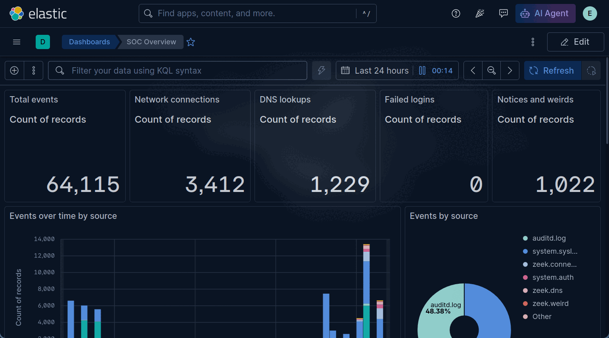

# laptop-setup

One script that turns a fresh **Ubuntu 26.04 + Hyprland** laptop into a hardened dev and DFIR/security-research machine, plus the "as code" pieces that go with it: a home SIEM, detection rules, dashboards, and a few small desktop tools.

It's a personal setup shared so you can borrow ideas. **Read it before running it.** It changes your firewall, SSH, kernel settings and USB policy.

> Built and tested piece by piece on one HP laptop (12th-gen Intel, 14 GB RAM). It has **not** been run top to bottom on a clean machine yet, so expect to adjust things. Issues and PRs welcome.

## Screenshots

**The SOC workspace**: a floating, translucent Kibana dashboard over the wallpaper (one key press, `soc`). Data is from this laptop's own Zeek, auditd and syslog.



**The bar**: a floating glass pill, icons only, details on hover. Left to right: workspaces, clock, pinned apps (hover the pin), tray, SIEM alerts (red = high/critical open), power draw, battery, temperature, Wi-Fi, volume, notifications, power menu.


Hover the pin and your pinned apps slide out (`barpin add "Name" <glyph> <command>` to add more):


## What's inside

| Area | What you get |
|---|---|
| **Hardening** | UFW (deny inbound, SSH/VNC only over Tailscale), fail2ban, sysctl hardening, auditd rules (RAW log format), USBGuard (block unknown USB, with a **popup to allow or deny** each new device), AIDE on `/home`, rkhunter, Lynis audit (62 -> 71 here) |
| **Home SIEM** (`siem/`) | Elasticsearch + Kibana + Filebeat in rootful Podman, localhost only, fed by **Zeek** (network), **auditd** and system logs. Capped RAM, 14-day retention |
| **Detection-as-code** (`siem/rules/`) | 13 YAML rules mapped to MITRE ATT&CK, pushed with `siem rules`. Each one was tested by reproducing the behaviour |
| **Sigma rules** (`siem/sigma/`) | 6 [SigmaHQ](https://github.com/SigmaHQ/sigma) rules converted to Elastic with `sigma-cli` and pushed with `siem sigma`. Only rules whose fields exist in this data are included, and why the others were skipped is in `siem/sigma/NOTICE.md` |
| **Dashboards-as-code** (`siem/dashboards.py`) | Three Lens dashboards (SOC Overview, Network/Zeek, Host Security), pushed with `siem dashboards` |
| **DFIR** | Velociraptor server in an unprivileged LXC container, Volatility 3, LiME memory capture (`memdump`) |
| **Mobile research** | Rooted Android emulator (AVD) with Frida, mitmproxy, jadx, apktool and snapshots (`avd`) |
| **Dev** | C toolkit (clang, valgrind, cppcheck, gdb), LazyVim, direnv, atuin, yazi, zellij, Podman, a global **gitleaks** pre-commit hook |
| **Desktop** | Tap-Super app grid, wallpaper-following terminal colours, power-draw and SIEM counters in Waybar, a floating translucent Kibana "SOC workspace", a floating glass bar with hover-to-reveal pinned apps (`barpin`) |
| **Backups** | Timeshift (latest snapshot only) + restic to Proton Drive (keeps last 2) |
| **Memory** | zram (7 GB, zstd) + earlyoom |

## Warnings, please read

- **This is a security-research lab setup.** The tools (Zeek, Velociraptor, Frida, LiME, Kali VM) are for machines and apps **you own or are explicitly authorised to test**. For bug bounties, stay inside each programme's scope and rules.
- **USBGuard blocks every USB device that wasn't plugged in when the policy was generated**, including external keyboards and mice. Plug your devices in first (see `usb()` in `setup.sh`).
- **Passwordless sudo is not part of this repo.** If you add it for automation on a test machine, remove it afterwards.
- **Secrets are never committed.** The SIEM passwords are generated at install time into `/etc/siem/.env` (root-only). `velociraptor/` (private keys), `dl/` (big downloads) and logs are git-ignored.
- **Personal values are in here** as defaults (user `void`, the LXC address `10.0.3.10`, a Proton Drive path). Search and replace them for your own setup.
- `setup.sh` is a collection of independent sections. Run the ones you want: `sudo bash setup.sh harden2 siem` rather than everything.

## Using it

```bash
git clone https://github.com/JackSessions/laptop-setup && cd laptop-setup
sudo bash setup.sh            # everything, in order (read it first!)
sudo bash setup.sh siem usb   # or just some sections
```

Sections are safe to re-run. See `ALL=(...)` near the bottom of `setup.sh` for the full list and order.

Some assets are **not** included because they are third-party: the GRUB theme and a login wallpaper. Those sections skip themselves if the files are absent.

## The SIEM in a minute

```bash
siem up          # start Elasticsearch, Kibana, Filebeat (~2 min, ~3 GB RAM)
siem pass        # print the generated 'elastic' password
siem dashboards  # (re)build the dashboards
siem rules       # (re)push the detection rules   |  siem rules --list
siem sigma       # convert + push the Sigma rules (needs: pipx install sigma-cli && sigma plugin install elasticsearch)
siem down        # stop it to free RAM
```

Kibana: `http://127.0.0.1:5601`. Write a rule by adding a block to `siem/rules/*.yml`:

```yaml
- id: my-rule
  name: Outbound connection to a classic C2 port
  query: 'event.dataset : "zeek.connection" and destination.port : (4444 or 31337)'
  severity: medium
  risk: 47
  mitre: [T1571]
```

Sigma works the same way: drop a Sigma `.yml` into `siem/sigma/rules/`, run `siem sigma`. It picks the right field mapping (`ecs_zeek_beats` for Zeek, `siem/sigma/auditd-ecs.yml` for auditd). A Sigma rule is only useful if your logs contain the fields it checks, so check with `--list` and test it.

Then test it by actually doing the thing. That caught a real bug here: Ubuntu's default *enriched* auditd format mangles the rule-key field Filebeat reads, so every auditd rule silently never fired until `log_format = RAW` was set.

## Layout

```
setup.sh        the whole machine, one function per section
bin/            small tools: ff, caffeine, powermode, avd, soc, memdump, ...
dotfiles/       config copied into place (Neovim notes, keybinds, fastfetch art, C starter project)
siem/           compose.yml, filebeat.yml, install.sh, dashboards.py, rules.py, rules/
backup/         restic-to-Proton-Drive scripts
```

## Rebuilding from scratch

1. Install Ubuntu, then your Hyprland desktop.
2. Clone this repo and put the large/private files in `dl/` (not in git).
3. `sudo bash setup.sh`.
4. Restore data from your backup, then do the manual bits: reboot, enrol the Secure Boot key (MOK) if you use VMware or LiME, `sudo tailscale up`, add your SSH key to GitHub.

## Licence

MIT for everything original here (see `LICENSE`). Sigma rules are from SigmaHQ under the Detection Rule License 1.1 (see `siem/sigma/NOTICE.md`). Third-party tools and the Pokémon sprites shown by `ff` (from `pokemon-colorscripts`) keep their own licences. Game and meme ASCII art in `dotfiles/fastfetch-art` is hand-drawn fan art for personal use.
